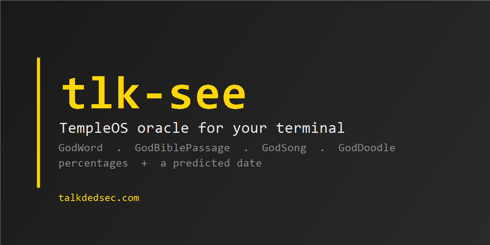

<p align="center">
  
</p>

<p align="center">
  <a href="https://talkdedsec.github.io/tlk-see/"><b>run it in the browser</b></a> ·
  <a href="README.tr.md">Türkçe</a> ·
  <a href="https://talkdedsec.com">talkdedsec.com</a> ·
  <a href="SECURITY.md">Security</a> ·
  <a href="LICENSE">MIT</a>
</p>

# tlk-see

TempleOS's oracle, in your terminal. Terry A. Davis let the Holy Spirit pick
words by latching a microsecond timer on every keypress; `tlk-see` keeps that
machinery bit for bit and adds a percentage spread and a predicted date.

One binary, no dependencies, no network.

```
$ tlk-see
  LEARNER          45%
  TRANSCRIPTION    22%
  PROJECT          17%
  PERVERSENESS     16%

  2027-07-16  (+258 days)

  The weight falls on LEARNER at 45%, with TRANSCRIPTION behind it at 22%.
  PROJECT and PERVERSENESS wait at the edge. The hour reads 2027-07-16,
  258 days out.
```

The list is the draw; the paragraph under it is that same draw read back as one
sentence, so there is something to read instead of four loose words.

## Install

Windows, through Scoop:

```sh
scoop bucket add tlk https://github.com/Talkdedsec/scoop-tlk
scoop install tlk-see
```

Or take a binary for Windows, Linux or macOS from
[releases](https://github.com/Talkdedsec/tlk-see/releases) and drop it on your
`PATH`. Or build it:

```sh
git clone https://github.com/Talkdedsec/tlk-see
cd tlk-see
cargo build --release
```

## Use

```sh
tlk-see                # 4 words with a percentage spread, plus a date
tlk-see -n 7           # seven words
tlk-see --tr           # Turkish vocabulary
tlk-see bible          # a random passage, 20 lines
tlk-see bible -l 5     # five lines
tlk-see song           # two measures twice, printed and played
tlk-see doodle         # a random sprite in half-blocks
```

Every draw needs entropy, so it waits for a keystroke — any key, ESC to quit.
The timer is read at that instant: you are the randomness, which was the whole
point in TempleOS. With stdin redirected, one line stands in for one key.

### A doodle

```
  ++++++++++++++++++++++++++++++++++++**        *****     ######*################
  ++++++++++++++++++++++++++++++++++++**                        *################
  +++++++++++++++++++++++++++*************                     ***###############
  **+++++++++++++++++++++++****        ***
  ++++++++++++++++++++***                ......
  +++++++++++++++***                     ...............
  ++++++++++**                           .....................***
  ++                       *              .....................               ***
```

### A song

```
$ tlk-see song
  5qDDsCCCCe4G5EqGCeGDC4G5qDDsCCCCe4G5EqGCeGDC4G5e4BGq5GetC4B5DeGCetGDEs4B5G4B5Gq4G5G
```

## Sharing a draw

Every draw prints its **record** — the hex `GodHexIns` reads, which is how
TempleOS replayed a doodle — and a link that replays it in the browser:

```
  record  f7f823fc4423d34423742423
  https://talkdedsec.github.io/tlk-see/#m=word&n=3&l=20&tr=0&d=20758&h=f7f823…
```

Hand the record back and the same draw returns, word for word and date for
date, in either build:

```sh
tlk-see -n 3 --hex f7f823fc4423d34423742423 --day 20758
```

The page has *copy link*, *copy reading* and *copy command* under each draw.
`--quiet` leaves the record out.


## What is faithful, what is new

Ported from the public-domain TempleOS source, unchanged — including the
modulo bias and the bit order:

| TempleOS | here |
|---|---|
| `GodBits` / `GodBitsIns` — 24-bit refills from a timer latched on a keypress, low 4 bits dropped | `src/god.rs` |
| `GodWord` — 17 bits modulo a 7569-word vocabulary | `src/god.rs`, `data/vocab-en.txt` byte for byte |
| `GodBiblePassage` / `BibleLine2Verse` — 21 bits over 100110 lines of the KJV | `src/bible.rs`, book tables lifted from `GodBible.HC` |
| `GodSongStr` — two measures of notes, Normal complexity | `src/song.rs` |
| `GodDoodleSprite` — strokes, flood fills, majority smoothing | `src/doodle.rs` |

Added here:

- **Percentages.** Each word gets a 10-bit weight from the same entropy, split
  into whole percents by largest remainder, so a run always totals 100.
- **A predicted date.** 10 bits modulo a 365-day horizon.
- **A Turkish vocabulary** (`--tr`), the same 7569 words deep, built from a
  frequency list intersected with a dictionary.
- **A terminal renderer** for the doodle (half-block cells) and playback for the
  song (PC speaker on Windows).

Known deviations are marked `shortcut:` in the source. The doodle runs one pass
of 20 strokes on an 80×80 canvas where TempleOS runs three passes of 29 on
640×480, because each stroke costs you keypresses.

## Is it random?

It is a timer read at the moment you press a key, exactly as in TempleOS. Good
enough for an oracle, useless for a password. Do not use it as a CSPRNG.

## Credits

Terry A. Davis (1969–2018) wrote TempleOS alone over ten years and released it
into the public domain. The King James text ships with it, from Project
Gutenberg. This is a port, not an improvement.

## License

MIT — see [LICENSE](LICENSE). Vulnerabilities: [SECURITY.md](SECURITY.md).
