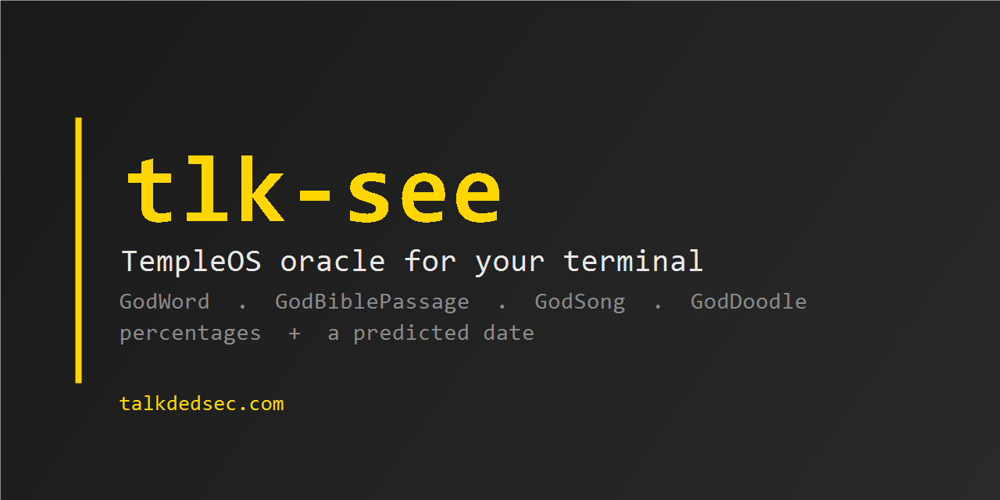

<p align="center">
  
</p>

<p align="center">
  <a href="README.md">English</a> ·
  <a href="https://talkdedsec.com">talkdedsec.com</a> ·
  <a href="SECURITY.md">Güvenlik</a> ·
  <a href="LICENSE">MIT</a>
</p>

# tlk-see

TempleOS'un kahini, terminalinde. Terry A. Davis her tuşa basışta mikrosaniyelik
bir sayacı mandallayıp Kutsal Ruh'a kelime seçtiriyordu; `tlk-see` o düzeneği
bit bit koruyor, üstüne yüzde dağılımı ve tahmini tarih ekliyor.

Tek binary, bağımlılık yok, ağ yok.

```
$ tlk-see
  press ENTER   press ENTER   press ENTER   press ENTER   press ENTER
  PERMITTED       57%
  OVERBOLDNESS    27%
  MOLEST          11%
  FOREFATHERS      5%

  2027-07-11  (+253 days)
```

## Kurulum

```sh
git clone https://github.com/Talkdedsec/tlk-see
cd tlk-see
cargo build --release
```

Binary `target/release/tlk-see` (Windows'ta `.exe`) olarak çıkar. `PATH`'teki
herhangi bir klasöre kopyalaman yeterli.

## Kullanım

```sh
tlk-see                # 4 kelime + yüzde dağılımı + tahmini tarih
tlk-see -n 7           # yedi kelime
tlk-see --tr           # Türkçe sözlük
tlk-see bible          # rastgele pasaj, 20 satır
tlk-see bible -l 5     # beş satır
tlk-see song           # iki ölçü iki kez; hem basılır hem çalınır
tlk-see doodle         # yarım blok karakterlerle rastgele sprite
```

Her çekiliş entropi ister, o yüzden ENTER'a basmanı söyler. Sayaç tam o anda
okunur — rastgeleliği sen üretiyorsun, TempleOS'ta da bütün mesele buydu.

## Neresi birebir, neresi bizim

Kamuya açık TempleOS kaynağından olduğu gibi portlandı — modulo sapması ve bit
sırası dahil:

| TempleOS | burada |
|---|---|
| `GodBits` / `GodBitsIns` — tuşa basışta mandallanan sayaçtan 24 bitlik dolum, alt 4 bit atılır | `src/god.rs` |
| `GodWord` — 7569 kelimelik sözlükte 17 bit modulo | `src/god.rs`, `data/vocab-en.txt` byte byte aynı |
| `GodBiblePassage` / `BibleLine2Verse` — KJV'nin 100110 satırında 21 bit | `src/bible.rs`, kitap tabloları `GodBible.HC`'den |
| `GodSongStr` — Normal karmaşıklıkta iki ölçü nota | `src/song.rs` |
| `GodDoodleSprite` — çizgiler, flood fill, çoğunluk yumuşatma | `src/doodle.rs` |

Eklenenler:

- **Yüzdeler.** Her kelime aynı entropiden 10 bitlik bir ağırlık alır, en büyük
  kalan yöntemiyle tam sayı yüzdelere bölünür; toplam her zaman 100.
- **Tahmini tarih.** 365 günlük ufukta 10 bit modulo.
- **Türkçe sözlük** (`--tr`), yine 7569 kelime; frekans listesi ile sözlük
  kesiştirilerek üretildi.
- **Terminal çizici** (yarım blok hücreler) ve şarkı çalma (Windows'ta PC
  hoparlörü).

Bilinen sapmalar kaynakta `shortcut:` ile işaretli. Doodle 80×80 tuvalde 20
çizgilik tek geçiş yapıyor; TempleOS 640×480'de 29 çizgilik üç geçiş yapar,
çünkü burada her çizgi sana tuş vuruşuna mal oluyor.

## Gerçekten rastgele mi?

Tuşa bastığın anda okunan bir sayaç, TempleOS'taki gibi. Kahin için yeterli,
parola için değil. CSPRNG yerine kullanma.

## Teşekkür

Terry A. Davis (1969–2018) TempleOS'u on yıl boyunca tek başına yazdı ve kamuya
açık bıraktı. King James metni de onunla geliyor, kaynağı Project Gutenberg. Bu
bir port, bir iyileştirme değil.

## Lisans

MIT — bkz. [LICENSE](LICENSE). Güvenlik açıkları: [SECURITY.md](SECURITY.md).
